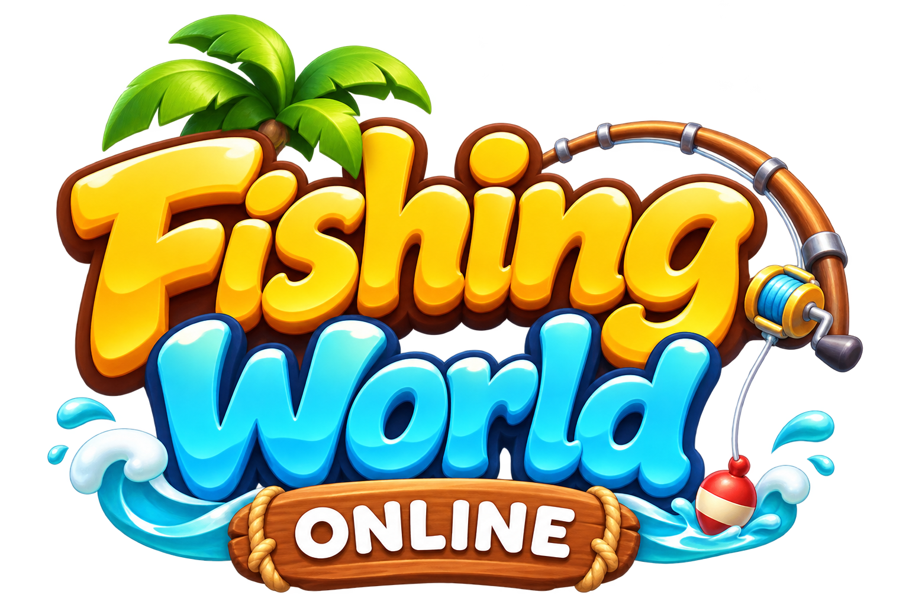
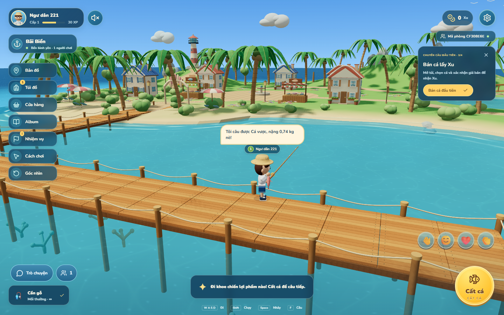
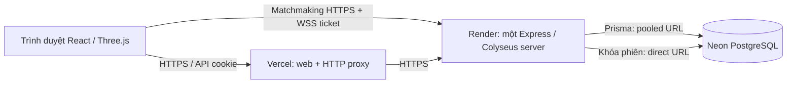

<p align="center">
  
</p>

<p align="center"><strong>Game câu cá 3D online — khám phá đảo, bắt cá và chia sẻ thành quả cùng bạn bè.</strong></p>
<p align="center">React · Three.js / React Three Fiber · Colyseus · Express · PostgreSQL / Prisma</p>



## Giới thiệu

Fishing World Online là game trình duyệt phong cách chibi, giao diện tiếng Việt, hỗ trợ máy tính và cảm ứng. Người chơi dùng phiên khách, vào cùng mã phòng, khám phá Bãi Biển/Làng Chài, câu 15 loài cá, bán lấy Xu, nâng cấp trang bị và hoàn thành nhiệm vụ. Tiến trình lưu trên PostgreSQL, không chỉ trong bộ nhớ trình duyệt.

**Trạng thái:** bản beta đang phát triển, đã kiểm chứng local; chưa có URL production công khai. Hình trên là ảnh game thật. Mỹ thuật hiện là mô hình stylized procedural, chưa tái tạo toàn bộ độ chi tiết của concept.

## Tính năng

- **Thế giới chung:** đảo khoảng 123 × 86 m, bến gỗ, làng, hồ nước ngọt, hải đăng, nước trong và sóng ven bờ; tối đa 20 người/phòng theo cấu hình hiện tại.
- **Di chuyển:** đi, chạy, nhảy; dự đoán tại máy người chơi, server xác nhận input và nội suy người khác; camera xoay tự do, chế độ 30/60 FPS.
- **Câu cá:** chỉ thả trong 2 m tới nước lộ thiên; nhấp giả, cửa sổ giật theo độ hiếm, bo cá tự động và xác suất hụt. Server chọn và xác thực toàn bộ kết quả.
- **Tiến trình:** 15 loài/4 độ hiếm, túi cá, album/kỷ lục, XP/cấp độ, Xu, 3 cần và 3 loại mồi; giao dịch chống gửi lặp.
- **Hoạt động:** khoe/cất cá chủ động, chat/emote, cộng đồng, mute/report và công cụ quản trị; nhiệm vụ khởi đầu và ngày, reset lúc 00:00 Việt Nam.
- **Trải nghiệm:** bốn ngoại hình, cài đặt đồ họa/âm lượng/camera tại lobby, nhạc streaming theo cảnh, hiệu ứng âm thanh và nút về lobby.
- **Lưu bền vững:** chỉ nhận cá/XP sau khi kéo thành công; kết quả kéo được lưu để reconnect/restart không lấy mẫu lại; sao lưu/kiểm tra khôi phục database.

## Kiến trúc



Đây là **một monorepo**, được triển khai thành các dịch vụ riêng. Phòng game giữ trạng thái trong RAM của backend, tài sản lưu ở database. Phiên khách có cookie HttpOnly/Secure trên domain frontend; matchmaking/WebSocket dùng ticket ngắn hạn, không phụ thuộc cookie bên thứ ba.

Backend hiện chỉ hỗ trợ **một tiến trình cho mỗi database** bằng advisory lock. Chưa hỗ trợ autoscaling nhiều instance, triển khai chồng phiên bản hoặc chuyển phòng liền mạch giữa các server. [Hướng dẫn production Vercel + Render + Neon](docs/PRODUCTION.md) giải thích cấu hình cụ thể.

## Yêu cầu

- Node.js **22.x**, pnpm **12.18.0**.
- PostgreSQL **17** hoặc database PostgreSQL tương thích trên Neon.
- Trình duyệt hỗ trợ WebGL; Docker Compose nếu dùng môi trường HTTPS local.

## Khởi động local

```bash
git clone https://github.com/tienmanhhk38-code/fishing-world.git
cd fishing-world
pnpm install --frozen-lockfile
```

Sao chép `apps/server/.env.example` thành `apps/server/.env`, đặt `DATABASE_URL` tới database **phát triển riêng**. Khởi động PostgreSQL bằng một trong hai cách:

```powershell
# Windows: cụm PostgreSQL riêng tại .local/postgres, cổng 55432.
powershell -ExecutionPolicy Bypass -File scripts/local-db.ps1
```

```bash
# Hoặc Docker; không chạy cùng cụm Windows trên cùng cổng.
docker compose up -d
```

Với **database mới, rỗng**:

```bash
pnpm db:generate
pnpm --filter @fishing/server exec prisma migrate deploy
pnpm dev
```

Mở **http://127.0.0.1:5173**. Để thử hai người, dùng hai trình duyệt/hồ sơ độc lập và cùng mã phòng. Hai tab cùng hồ sơ chia sẻ khách; chỉ một tab được vào bến. Cookie bị xóa sẽ tạo phiên khách mới; liên kết tài khoản để khôi phục danh tính chưa triển khai.

Database cũ đã tạo bằng `db push` phải được backup và đối chiếu/baseline trước khi dùng migrations; xem [vận hành database](docs/DEPLOYMENT.md). Không reset database đang có tiến trình người chơi.

## Điều khiển

| Thao tác | Máy tính | Cảm ứng |
| --- | --- | --- |
| Di chuyển | WASD / mũi tên | Joystick trái |
| Chạy | Giữ Shift | Nút Chạy bật/tắt |
| Nhảy | Space | Nút Nhảy |
| Xoay camera | Kéo chuột trên cảnh | Kéo vùng cảnh bằng ngón khác |
| Thả / giật câu | F hoặc nút hành động | Nút hành động phải |
| Chat | Enter; gõ bình thường trong ô chat | Nút Trò chuyện |
| Về lobby | Cài đặt → Về lobby | Cài đặt → Về lobby |

Chờ phao chìm và dấu **!** để giật. Cửa sổ giật là 900/700/550/400 ms theo độ hiếm, bù RTT tối đa 150 ms. Bấm sớm/quá hạn hoặc kéo hụt không nhận cá/XP. Sau thành công chọn **Câu tiếp**, **Khoe cá** hoặc **Xem túi**; đang khoe phải **Cất cá** trước khi câu lại.

## Cấu trúc repository

```text
apps/client/       React/Vite, cảnh 3D, UI, âm thanh và assets
apps/server/       Express/Colyseus, luật game, giao dịch và Prisma migrations
packages/shared/   Hợp đồng mạng, map/collision, catalog và bảng cân bằng
api/               Vercel HTTP proxy giữ cookie cùng domain web
deploy/            Caddy, ví dụ environment, quyền Neon và cấu hình vận hành
scripts/           Build assets, backup/restore, kiểm tra và đo tải/render
tests/             Unit test và Playwright/integration test
design/reference/  Ảnh thiết kế tham chiếu
docs/              Hướng dẫn, báo cáo và phạm vi nghiệm thu
render.yaml        Blueprint backend đơn instance trên Render
vercel.json        Build frontend và Vercel Functions proxy
```

## Lệnh thường dùng

| Lệnh | Mục đích |
| --- | --- |
| `pnpm dev` | Chạy client và backend local |
| `pnpm build` | Kiểm tra TypeScript và build cả workspace |
| `pnpm test` | Unit test |
| `pnpm test:browser` | Chromium UI/API/integration |
| `pnpm test:cross-browser` | Luồng âm thanh/game trên Firefox và WebKit |
| `pnpm db:generate` | Sinh Prisma Client |
| `pnpm db:backup` | Backup + manifest kiểm chứng |
| `pnpm db:restore-verify` | Restore vào database mới và đối chiếu digest |

Playwright cần server local đang chạy, database test riêng và browser đã cài: `pnpm exec playwright install chromium firefox webkit`. Một số test tạo dữ liệu trực tiếp trong database; không chạy với database production. Harness `test:release` còn kill/restart Docker để thử recovery, chỉ dành cho beta local.

Sau `pnpm build`, `pnpm --filter @fishing/server start` phục vụ cả web/API/WebSocket tại http://127.0.0.1:2567. Không chạy đồng thời hai backend dùng cùng database.

## Production thử nghiệm

**Khuyến nghị:** Vercel cho frontend/proxy, Render cho backend chạy lâu dài và Neon cho PostgreSQL. Không đưa nguyên tiến trình Colyseus hiện tại vào Vercel Functions.

1. Tạo Neon project/branch production và role game, cấp quyền theo `deploy/neon-grants.sql`.
2. Tạo Render Blueprint từ `render.yaml`, nhập URL database/origin frontend và giữ cấu hình một instance + disk ngăn rolling deploy chồng tiến trình.
3. Import repo vào Vercel với Root Directory là **gốc repository**; đặt `VITE_GAME_SERVER_URL` và `GAME_SERVER_URL` bằng HTTPS origin của Render.
4. Cập nhật `APP_ORIGINS` trên Render đúng URL frontend; triển khai, kiểm tra hai khách cùng phòng và reload giữ túi.

Xem **[hướng dẫn từng bước, bảng biến môi trường và cách cập nhật](docs/PRODUCTION.md)**. Cấu hình đã chuẩn bị; tài khoản, secrets, dịch vụ trả phí và deploy công khai cần thiết lập trên các nhà cung cấp. Local progress không tự chuyển lên Neon mới; hướng dẫn có bước chuyển dữ liệu riêng.

## Kiểm chứng và giới hạn

Báo cáo ngày 11/11/2026 ghi nhận unit/integration, hai khách cùng phòng, giao dịch đồng thời, recovery khi SIGKILL và mất/khôi phục WebGL. Lượt nâng cấp đo 20 khách HTTPS/WSS trong 3 phút, 170 cá lưu, không sai lệch tài sản; render desktop Intel UHD 730 ở 1280×800 đạt khoảng 50–59 FPS chế độ Đẹp trong điều kiện đo đã ghi.

Đây là kết quả local có điều kiện, không phải SLA production hoặc chứng nhận 400 người. Chưa nghiệm thu Android/iOS thật hay playtest năm người mới. Port WebKit Windows thiếu Web Audio dùng âm thanh HTML dự phòng; cần nghe/đo Safari thật riêng.

- [Báo cáo nâng cấp và điều kiện đo](docs/EXPERIENCE-UPGRADE.md)
- [Dữ liệu kiểm chứng](docs/validation/experience-upgrade-2026-11-11.json)
- [Phiếu thử nghiệm người/thiết bị thật](docs/PLAYTEST.md)
- [Vận hành Docker, backup/restore](docs/DEPLOYMENT.md)
- [Lịch sử dự án](docs/PROJECT-HISTORY.md)

## Tài nguyên và quyền sử dụng

Asset gốc, manifest và ghi chú tác giả được giữ trong `apps/client/public/assets/starter/`. Mô hình Harbor do code tạo nằm ở `apps/client/src/art/harbor-author.ts`; logo, ảnh tham chiếu và hai bài MP3 được người dùng cung cấp. Việc xuất bản repository không tự cấp phép tái sử dụng các tài nguyên đó. Dự án chưa chọn giấy phép mã nguồn mở; cần xác nhận quyền sử dụng nhạc/hình ảnh trước khi phân phối thương mại.

Không commit `.env`, secrets, dump database, cookie, log hay dữ liệu `.local/`. Các file `.env.example` chỉ chứa giá trị minh họa.
