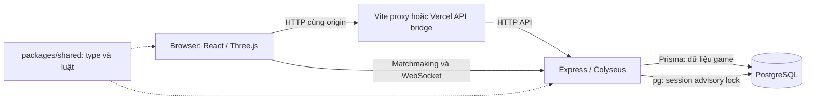

# Kiến trúc và luồng xử lý

## Các thành phần



- **Client:** `main.tsx` ghép lobby, HUD, input và các panel. `scene.tsx` điều phối môi trường, nhân vật, phao, camera và render loop. `scenery.tsx`, `IslandWater.tsx`, `IslandDecor.tsx`, `TropicalDetails.tsx`, `Grounding.tsx`, `island-geometry.ts` dựng đảo.
- **State client:** Zustand trong `network.ts`, `social-client.ts`, `economy-client.ts`, `settings.ts`; snapshot actor ở `world: Map`. `motion-client.ts` xử lý prediction/interpolation, tách khỏi UI React.
- **Server:** `index.ts` chứa HTTP API và class phòng `Beach`; mỗi phòng có map player/input/round, timer, social và residents. Mô phỏng và gửi `WORLD` mỗi 50 ms; không dùng schema patch để đồng bộ trạng thái game.
- **Domain:** `economy.ts` quản lý tài sản/lượt câu; `quests.ts` tính tiến độ; `social.ts` chat và moderation; `fishing.ts` tạo lịch cue; `catch-selection.ts` lấy mẫu cá bằng random phía server.
- **Shared:** type mạng ở `index.ts`; `world.ts` là nguồn map/collision/điểm đến; `movement.ts` mô phỏng chung; catalog, fishing rules, quests và residents dùng ở cả hai phía.

## Phiên khách và kết nối

1. `GET /api/guest` đọc cookie hoặc tạo `Guest`. Cookie giữ token ngẫu nhiên; DB giữ SHA-256 của token qua `sessions.ts`.
2. API trả profile và ticket sống 30 giây. `matchmaking.ts` kiểm tra origin, payload, capacity và giữ ticket cho seat được cấp.
3. WebSocket `onAuth` tiêu thụ ticket, đối chiếu `roomId/sessionId`, kiểm tra ban và guest đang chơi ở tab khác.
4. Client nhận `WELCOME`, `PROFILE`, `SESSION`, rồi các snapshot `WORLD`. `PING/PONG/RTT` phục vụ đo latency và bù thời gian giật.
5. Disconnect không chủ ý cho phép reconnect trong 30 giây. Client lưu reconnection token trong `sessionStorage`; hết hạn phải vào phòng lại. Rời lobby chủ ý đi qua `LEAVE_GAME` → `LOBBY_READY`.

Ở local, Vite proxy `/api` và `/socket`; khi build chung, Express phục vụ `apps/client/dist` và WebSocket cùng host. Khi tách frontend, HTTP vẫn gọi `/api` trên origin frontend qua Vercel bridge; matchmaking/WSS đi thẳng tới `VITE_GAME_SERVER_URL`. Bridge không chuyển WebSocket hoặc metrics.

## Di chuyển và render

Client đổi keyboard/joystick thành `PLAYER_INPUT` có `seq` khoảng mỗi 50 ms; nhảy gửi `PLAYER_JUMP`. Client dự đoán bằng luật shared; server mô phỏng collision, loại input cũ và trả `ackSeq/snapshotAt`. Input quá 250 ms bị coi là không di chuyển. Các actor khác được nội suy; teleport hợp lệ xóa input và reset prediction.

Model đi qua `assets.tsx`: ánh xạ asset starter sang Harbor khi có bản nâng cấp, cache/bake mesh và instancing. `HarborCharacter.tsx` quản lý nhân vật; cá có skin/LOD và animation riêng. Source tạo model nằm trong `src/art/`, file phục vụ nằm ở `public/assets/`.

## Lượt câu và dữ liệu bền vững

```text
IDLE → CASTING → WAITING → APPROACHING ↔ NIBBLING
     → BITE_WINDOW → REELING → RESULT → SHOWCASING hoặc IDLE
```

- `startFishing` kiểm tra vị trí/phase; `beginFishing` khóa account, trừ mồi hữu hạn, chọn `selected` và `plan` (gồm khả năng thoát), lưu `FishingRound` rồi mới phát cue.
- `hook` kiểm tra round ID và thời điểm trên server. Giật hợp lệ gọi `startReel`, lưu `hookedAt/reelEndsAt`; client nhận timing để hiển thị, không tự quyết định kết quả.
- `settleReel` đọc kết quả đã lưu. Thành công gọi `commitCatch`: chuyển trạng thái, tạo cá, cập nhật album/XP/revision trong transaction. Thoát cá chuyển `ESCAPED`, không cấp thưởng.
- Startup lấy instance lock rồi chạy `recoverFishing` trước khi listen: lượt `REELING` được giải quyết theo plan cũ, lượt `ACTIVE` bị gián đoạn và hoàn lại mồi hữu hạn. Hủy chủ ý không áp dụng hoàn mồi như gián đoạn.

`Phase` trên mạng và `FishingRound.status` trong DB là hai tập trạng thái khác nhau; xem [PROTOCOL-DATA](PROTOCOL-DATA.md).

## Tính nhất quán và bảo vệ

- Giao dịch account dùng Prisma transaction + `SELECT ... FOR UPDATE` trên `Guest`. Sale quote chốt tập cá/giá; operation có `requestId` và fingerprint, không cho dùng lại ID với payload khác.
- Quest claim có khóa duy nhất theo guest/quest/period và guest/request. `CoinLedger` ghi biến động Xu; `Fish.roundId` unique ngăn cấp cá hai lần.
- `Profile.revision` chỉ tăng khi cập nhật tiến trình; client và phòng bỏ qua profile cũ để tránh phản hồi bất đồng bộ ghi đè dữ liệu mới.
- Cấu hình production yêu cầu origin HTTPS chính xác; HTTP/WS có rate limit, body/frame tối đa 4 KB. Metrics cần bearer token; session cookie là HttpOnly/SameSite=Lax, thêm Secure và prefix `__Host-` khi production.
- Bot/NPC có snapshot giống actor nhưng không đi qua account/economy; không dùng số actor hiển thị làm số người thật.

## Lifecycle và giới hạn triển khai

`instance-lock.ts` giữ PostgreSQL session advisory lock bằng kết nối `pg` riêng; kiểm tra mỗi 5 giây. Khi mất lock, server shutdown. Khi tranh lock, startup có thử chấm dứt backend DB đang giữ lock bằng `pg_terminate_backend`; không thể coi việc bật server thứ hai là một phép thử an toàn trên DB dùng chung.

Graceful shutdown ngừng nhận thao tác, dọn timer, chờ operation được theo dõi, xử lý lượt đang chạy rồi đóng Prisma/lock. Room, presence và ticket nằm trong RAM; không có distributed presence/driver trong cấu hình hiện tại. Triển khai phải tránh chạy chồng backend cùng database; cấu hình chi tiết ở [PRODUCTION](PRODUCTION.md).
