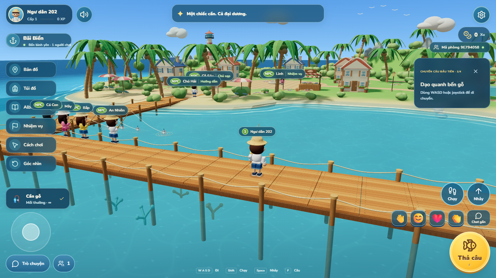
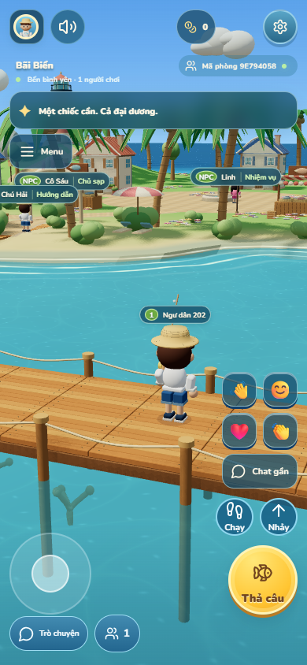
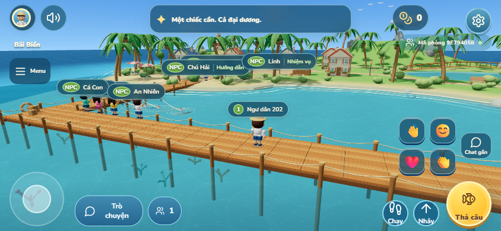
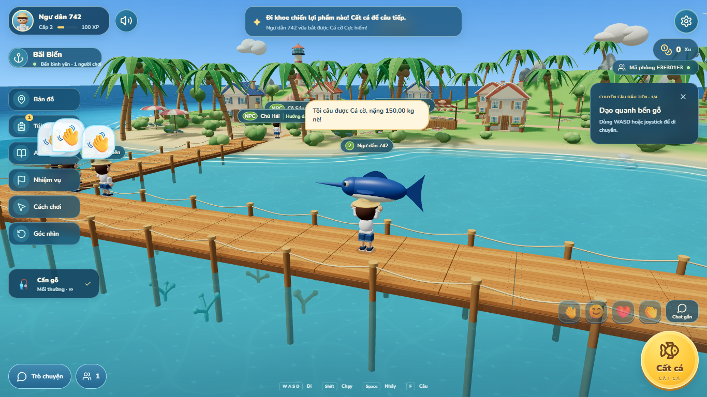

# Nâng cấp giao diện và trải nghiệm — 12/11/2026

Bản build chạy local tại http://127.0.0.1:2567; bản dev tại http://127.0.0.1:5173. Chưa phát hành công khai. Ảnh, video, số đo và bản sao lưu trước migration nằm trong `.local/upgrade-v5/`.

## Hành vi mới

- HUD có bố cục desktop, điện thoại dọc và ngang; vùng bấm cảm ứng tối thiểu 44 px. `responsive.css` là nơi quản lý hình học HUD; các CSS cũ giữ màu sắc và bố cục nội dung từng bảng. Popup dùng liquid glass có fallback khi thiếu blur, tính safe area và chiều cao bàn phím qua VisualViewport.
- Thông báo chuyển lên trên; cảnh báo cá cắn được ưu tiên. Các giao dịch vẫn có lỗi tại bảng đang mở và nút thử lại cùng request ID.
- Chat thế giới giữ phạm vi cùng phòng. Chat gần là kênh riêng trong 20 m, tối đa 160 ký tự, dùng chung hạn 1 tin/giây, hiện trên đầu trong 6 giây. Không phát lại bong bóng khi reconnect. Tin gần vẫn được lưu cùng channel để quản trị và báo cáo.
- Năm điểm dịch chuyển: Bãi Biển, Bến câu biển, Làng Chài, Hồ nước ngọt, Hải đăng. San Hô và Đảo Bí Ẩn còn khóa. Server quyết định tọa độ, yêu cầu thu cần và cooldown 2 giây; gói `area` cũ tiếp tục hoạt động.
- Cô Sáu mở cửa hàng khi đứng trong 3 m, Chú Hải mở hướng dẫn, Linh mở nhiệm vụ. Bộ đếm Xu và menu không còn mở cửa hàng. Bán cá và thay trang bị giữ luồng trong túi.
- Người câu ảo do server điều khiển, có nhãn NPC, không có tài khoản/tài sản hoặc chiếm suất phòng. Phòng dưới 5 người thật được bổ sung cho ít nhất 5 người; giữ số đã có ở mức 5–10, trên 10 rút một người mỗi 5 giây; phòng trống được dọn.
- Cá bơi vòng và tiến tới phao; phao chỉ nhấp sau tiếp xúc. Cắn thật rung rồi chìm, dấu `!` nhỏ trên đầu. Giật sớm, quá hạn và đứt dây có nguyên nhân riêng; đứt dây xảy ra sau bo cá, có tiếng bật dây và cá lao đi. Giữ quyết định kết quả và chốt thưởng tại server.
- Sóng ven bờ dùng pháp tuyến đường bờ, nước tràn/rút trên cát và vùng ướt; hồ ít gợn hơn. Bóng cá có thân tròn, vây và đuôi vẫy. Tiếng bo cá tăng gain từ 0,65 lên 1,0, cá cắn thêm âm rung, vòng kéo dừng theo vòng đời lượt câu.
- Catalog đủ 30 loài, từ cá cơm đến cá cờ/cá tra dầu/cá hải tượng 150 kg. Kích thước dùng cùng hàm theo loài/cân nặng, giới hạn chiều dài hiển thị 0,2–4 m. Từ 10 kg, nhân vật ẩn cần và dùng hai tay đỡ cá trên đầu, kể cả khi đi/chạy/nhảy. Cá cũ giữ giá bán đã lưu.

## Dữ liệu và giao thức

Migration `202611120001_nearby_chat` thêm `ChatMessage.channel` mặc định `world`, không xóa hoặc đổi dữ liệu cá cũ. Database local đã được sao lưu trước khi áp dụng (`before.dump` và manifest, 16 bảng). Môi trường khác cần backup rồi chạy:

```powershell
pnpm db:generate
pnpm --filter @fishing/server exec prisma migrate deploy
pnpm build
```

`CHAT_SEND` nhận thêm channel tùy chọn (`world` mặc định, `nearby`); `CHAT_MESSAGE` có channel, playerId và expiresAt cho bong bóng. Snapshot thêm kind, phaseStartedAt, phaseDurationMs và motionSeed; không gửi trước kết quả thắng/hụt. `TELEPORT_REQUEST` hỗ trợ destination mới và area cũ. `FISH_ENDED` có mã early/late/line_break/cancelled khi kết thúc hụt/hủy; `FISH_ESCAPED` xác định line_break và vị trí thoát.

Model cá mới được tạo bằng mã Three.js gốc trong `art/fish-author.ts`. Có thể tái tạo GLB và ảnh album bằng `node scripts/build-fish-assets.mjs` khi Vite đang chạy tại cổng 5173. Không phụ thuộc dịch vụ tạo ảnh hoặc tải model bên ngoài.

## Giới hạn kiểm chứng

Kiểm thử cảm ứng là giả lập Chromium/CDP, chưa thay thế thử trên Android/iPhone thật. WAV được kiểm tra giải mã, mức tín hiệu và vòng đời playback; chưa đánh giá bằng tai trên loa điện thoại thật. Số đo render là trên máy phát triển, không phải cam kết FPS cho mọi thiết bị. Các fixture ép cá/kết quả chỉ nằm trong kiểm thử qua database local; không có API ép kết quả trong game.

## Kết quả kiểm chứng

- Build TypeScript/Vite đạt; JS/CSS đang phục vụ ở cổng 2567 khớp SHA-256 bản build. `git diff --check` đạt.
- 38 unit test đạt. Đã xác nhận đủ 33 kịch bản Chromium: lượt tổng cuối đạt 32/33, bài hình ảnh nhấp được sửa cách quan sát phase 200–350 ms và chạy lại đạt. Thay đổi harness không nới cửa sổ giật hoặc nhịp game. Hai bài âm thanh trên Firefox và hai bài trên WebKit đều đạt.
- Có ảnh ở sáu kích thước màn hình, gồm popup bản đồ/cửa hàng; chat gần được kiểm tra tại 19,9/20,1 m, mua hàng ở 2,99/3,01 m và retry sau khi rời phạm vi. Kiểm tra giật sớm/đứt dây không tạo cá/XP, chốt lượt đồng thời, recovery, dữ liệu cũ, mute/report và giới hạn 20 người thật đều đạt.
- Cảm ứng CDP hai pointer đồng thời: đi 2,78 m, xoay camera 0,42 rad; nhảy được đo cao thêm 0,78 m tại mẫu lấy, nút chạy bật đúng. Đây là giả lập, chưa phải điện thoại thật.
- 15 GLB mới tổng 392.636 byte, kèm 15 ảnh album. Tư thế cá 150 kg được xác nhận dài 4 m, hai tay nâng và cần ẩn; có video toàn bộ nhấp → bo → đứt dây/cá lớn. Bóng cá dùng các hình tròn chung trong instancing và một đuôi riêng, thay cho ba khối cầu dẹt mỗi con.
- WAV mới không có mẫu chạm clipping: peak bo cá 0,075; cá cắn 0,332; đứt dây 0,492 (thang chuẩn hóa 1,0). Chưa đánh giá bằng tai trên thiết bị thật.

### Render và giới hạn so sánh

Các lượt dưới đây dùng Chromium/D3D11, 1280 × 800, 20 khách mạng thật, tám hướng camera, giới hạn 60 FPS. Bản mới còn có NPC và giai đoạn rút người ảo. Máy có tải nền; các lượt đo dao động mạnh, nên chưa đủ cơ sở quy kết chênh lệch FPS riêng cho game hoặc chứng nhận hiệu năng tương đương baseline. Không có page error hoặc mất cảnh trong các lượt đo.

| Chế độ    | Baseline FPS theo góc | Bản mới FPS theo góc | p95 cao nhất bản mới | Draw call đỉnh bản mới |
| --------- | --------------------: | -------------------: | -------------------: | ---------------------: |
| Tiết kiệm |             54.5–58.9 |             2.5–59.1 |             805.5 ms |                    227 |
| Đẹp       |             50.3–58.7 |             9.3–57.4 |             140.5 ms |                    200 |

Lượt dev đầu tiên ở chế độ tiết kiệm đạt khoảng 57,5–59,5 FPS, trong khi các lượt build cuối có nhiều spike dài. Vì điều kiện nền không ổn định, cần đo lại trên máy ít tải nền trước khi kết luận mục tiêu FPS. Số liệu thô không bị loại bỏ: `render-low-final.json`, `render-high-final.json` và các lượt trước đều ở `.local/upgrade-v5/`. Tổng hợp có cấu trúc nằm tại `docs/validation/experience-v5.json`.

## Ảnh bàn giao









Video kiểm chứng cuối: `.local/upgrade-v5/fishing-effects.webm`. Ảnh popup và sáu kích thước đầy đủ vẫn nằm trong `.local/upgrade-v5/`.
